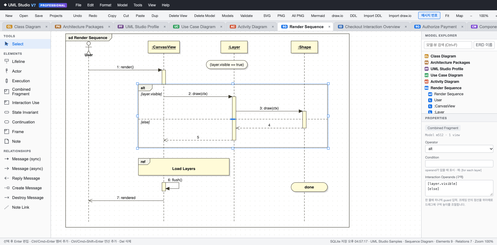
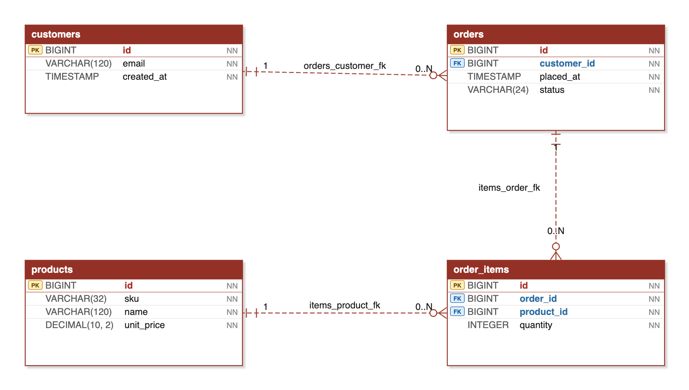
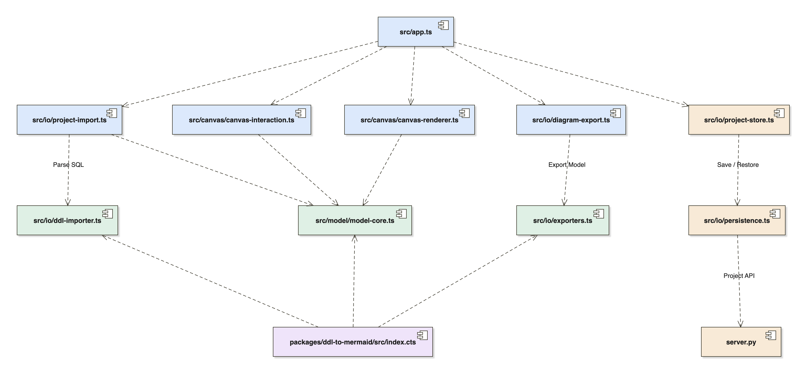
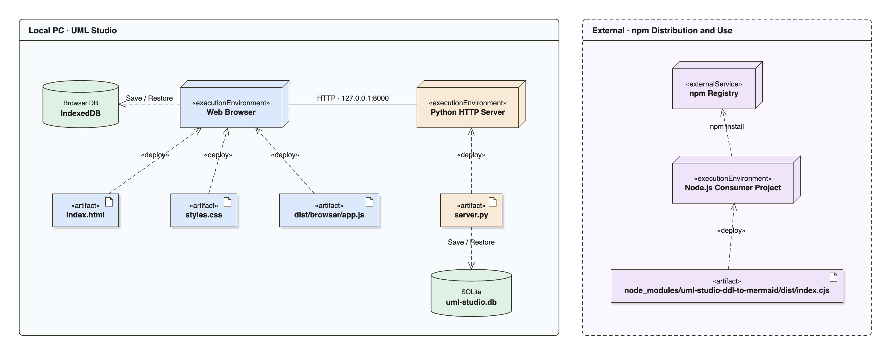

# UML Studio

UML Studio is a browser-based editor for UML, SysML, and entity–relationship diagrams. Build models across multiple diagrams, validate them as you work, and export the results for documentation or further editing. The local server saves projects to SQLite and keeps a recovery history.



_The built-in Render Sequence example shows lifelines, messages, and an `alt` combined fragment._

## Quick start

### DDL-to-Mermaid npm package

Use Node.js 24 or later to convert SQL DDL into an ERD model and Mermaid source. [View the package on npm](https://www.npmjs.com/package/uml-studio-ddl-to-mermaid).

From your Node.js project directory, install the package and use the bundled example to generate `schema.mmd` from the sample SQL.

```bash
npm install uml-studio-ddl-to-mermaid
node node_modules/uml-studio-ddl-to-mermaid/examples/convert.mjs > schema.mmd
```

Pass the path to your own SQL file to convert that schema.

```bash
node node_modules/uml-studio-ddl-to-mermaid/examples/convert.mjs ./schema.sql > schema.mmd
```

See the [package README](packages/ddl-to-mermaid/README.md) for API usage.

### Run the browser editor locally

You need Node.js 24 or later and Python 3.12 or later. Set up the editor once.

```bash
git clone https://github.com/MSbtff/uml-studio.git
cd uml-studio
npm ci
```

From the `uml-studio` directory, run this each time you want to open the editor.

```bash
npm start
```

`npm start` builds the TypeScript editor, starts the local Python server, and opens the editor in your default browser. You can also visit [http://127.0.0.1:8000](http://127.0.0.1:8000). To start the server without opening a browser, run `npm start -- --no-open-browser`.

The editor starts in English. To use Korean, open **Settings**, choose **한국어** under **Editor language**, and select **Apply**. The editor saves the project before reloading and remembers your choice in this browser.

The first launch creates a sample project. Browse its diagram tabs or choose **Projects** to create a blank project.

Project changes are automatically saved to `uml-studio.db` in the repository root. Once the editor is built, you can run the server directly with a different port or database path.

```bash
python3 server.py --port 8080 --db /path/to/uml-studio.db
```

For a static preview, run `npm run preview` and open [http://127.0.0.1:8765](http://127.0.0.1:8765). After `npm run build`, you can also open `index.html` directly or serve `index.html`, `styles.css`, and `dist/browser/` from a separate static directory. The static editor uses IndexedDB and a browser recovery copy. Use the same browser profile and URL origin to reopen its saved projects.

## Diagrams and editing

| Family                        | Diagram types                                                                                              |
| ----------------------------- | ---------------------------------------------------------------------------------------------------------- |
| UML structure                 | Class, Object, Package, Profile, Component, Deployment, Composite Structure                                |
| UML behavior and interactions | Use Case, Activity, State Machine, Sequence, Communication, Timing, Interaction Overview, Information Flow |
| SysML                         | Requirement, Block Definition, Internal Block, Parametric                                                  |
| C4                            | System Context (L1), Container (L2)                                                                        |
| Other                         | ER Diagram, Data Flow Diagram, Mind Map                                                                    |

- Use **Models** to place another view of an existing model on a diagram. Copies of class, interface, and enumeration views share the same underlying model, so a rename appears in every view.
- Copying or duplicating ERD tables, sequence lifelines and combined fragments, instances, nodes, components, and artifacts creates independently editable models. Lifelines and instances keep their original classifier references. Cut and paste moves the existing view and keeps its model.
- In a sequence diagram, use **Edit → Select All** before dragging to move lifelines, messages, execution bars, and fragments together. Drag a selection rectangle on empty canvas to move a smaller region. Drag a fragment's dashed divider to resize its operands.
- Use **Validate** or `F9` to check the project against its modeling rules.
- Use **Save** for a portable JSON project backup. Export diagrams to SVG, PNG, Mermaid (`.mmd`), or editable draw.io files. **All PNG** exports every diagram as an image. Use **Import draw.io** to bring draw.io diagrams into the current project.

### C4 architecture diagrams

Create a **C4 System Context** diagram and add people, software systems, and their relationships. Select a software system and choose **Open Container Diagram** in Properties. UML Studio creates the L2 diagram on the first visit and reopens it on later visits. Its system boundary shares the L1 system model, so changes to the system name appear in both views.

Place applications and databases inside the boundary and set their technologies and relationship protocols in Properties. Select the boundary to return to a **System Context** view. Both C4 diagrams support project JSON, autosave, and SVG export.

## Import and export SQL DDL

Choose **Import DDL** to preview a `.sql` file and add it to the current project as a new ER diagram. The preview lists tables, columns, foreign-key links, `CHECK` constraints, indexes, and any import warnings. From an ER diagram, choose **DDL** to export `CREATE TABLE` statements for PostgreSQL, MySQL, or SQLite.



_An online store schema imported from SQL into the ER diagram editor._

- The importer handles common PostgreSQL, MySQL, and SQLite `CREATE TABLE` syntax, including primary keys, `NOT NULL`, single-column foreign keys, `UNIQUE`, `DEFAULT`, `CHECK`, and simple column indexes. It parses files up to 10 MB in the browser without executing SQL.
- The column editor exposes single-column uniqueness and defaults. The entity properties expose `CHECK`, composite `UNIQUE`, and regular or unique indexes. Relationship properties expose `ON DELETE` and `ON UPDATE` actions. `SET NULL` requires a nullable FK column. `SET DEFAULT` requires a default for a non-nullable FK column, and MySQL export rejects that action because the target is InnoDB.
- Imports warn about `MATCH`, `DEFERRABLE`, database-specific index options, and references to tables outside the input. Composite foreign keys, expression indexes, `ALTER TABLE`, and `CREATE TABLE AS` stop the import with an error.
- Model Explorer searches logical and physical names of entities and columns. Use the ERD name tool (**ERD Names**) beside the search box to preview a project-wide rename. Renames update affected FK, `CHECK`, and index references across diagrams. An FK column deletion previews affected relationships and clears their column bindings and referential actions. Undo restores the previous state.

For SQL conversion from a Node.js script, see the [npm quick start](#ddl-to-mermaid-npm-package).

## Projects and recovery

- Open **Projects** or **File → Project Manager…** to create and switch between projects.
- Each project keeps its latest 10 autosave snapshots. Open **File → Recovery History…** to inspect timestamps and revisions and restore a snapshot. The editor saves the current state before restoring an older one.
- If two tabs edit the same project, revision checks stop an older tab from silently overwriting newer changes. Older single-project autosaves migrate into the project store on first launch.
- The status bar reports uncaught runtime errors and keeps a count until the page reloads.
- The server uses WAL when the installed SQLite includes the WAL-reset concurrency fix. It uses rollback journaling on older versions. Check the active mode at `/api/health`.

## Keyboard navigation

| Area                     | Controls                                                                                                                                                                                                                                                            |
| ------------------------ | ------------------------------------------------------------------------------------------------------------------------------------------------------------------------------------------------------------------------------------------------------------------- |
| Menu bar and toolbar     | `Tab` enters each region. `Left` and `Right` move between controls. `Home` and `End` jump to the first or last item.                                                                                                                                                |
| Menus                    | `Enter`, `Space`, or `Down` opens at the first item. `Up` opens at the last item. Use arrow keys or type an item's first letter to navigate. `Escape` or `Tab` closes the menu and restores focus.                                                                  |
| Model Explorer           | Press `Down` from search to enter the tree. Use arrow keys to navigate or expand nodes, `Home` and `End` to jump, and `Enter` or `Space` to select. Type a first letter to find a matching item.                                                                    |
| Canvas                   | `Tab` and `Shift+Tab` cycle through elements and relationships. Focus can leave the canvas at the ends of the selection order. `Escape` clears selection. Arrow keys move a selected element by one pixel, and `Shift` plus an arrow key moves it by one grid step. |
| Diagram tabs and toolbox | Use `Left`, `Right`, `Home`, and `End` on diagram tabs. `F2` renames the focused tab and `Delete` closes it. When the new-diagram menu opens, focus moves to the first diagram type. Use `Tab` to navigate toolbox items and `Enter` or `Space` to select one.      |

The status bar announces canvas selection and scrolls off-screen selections into view. QuickEdit and the Properties panel expose field labels and group relationship endpoints. Property refreshes restore focus to the control being edited. Project and recovery lists include item names in row action labels.

## Architecture

### Components

`src/app.ts` wires together canvas input, SVG rendering, project import and export, and persistence.



_Editor modules and the project storage API._

### Deployment

`npm start` builds the browser assets and starts `server.py` on the local machine. The browser keeps a recovery copy in IndexedDB, and the server stores projects in `uml-studio.db`. Node.js projects install the conversion library from npm and run it in their own process.



_Local editor deployment with `npm start` and npm package usage in a separate Node.js project._

## Development and tests

| Path                       | Contents                                                  |
| -------------------------- | --------------------------------------------------------- |
| `src/app.ts`               | Editor startup and module wiring                          |
| `src/model/`               | Semantic models, parsers, validation, and sample diagrams |
| `src/canvas/`              | SVG rendering, layout, and canvas input                   |
| `src/editor/`              | Toolbar, property panel, tabs, commands, and undo/redo    |
| `src/io/`                  | Import, export, project persistence, and recovery         |
| `packages/ddl-to-mermaid/` | Node.js package, public types, and examples               |
| `tests/`                   | Unit, SQLite HTTP integration, and browser tests          |

Edit TypeScript in `src/` and run `npm run build` to regenerate browser scripts in `dist/browser/`. `npm run typecheck` checks both the editor and the DDL package in strict mode.

Install development dependencies and the Chromium test browser.

```bash
npm ci
python3 -m venv .venv
source .venv/bin/activate
python -m pip install -r requirements-dev.txt
npx playwright install chromium
```

Run `npm test` for the unit, server, and browser suites. Run `npm run check` for linting, formatting, type checks, unit coverage, and SQLite HTTP integration tests. CI enforces 85% line, 80% branch, and 87% function coverage.

| Command                      | Scope                                                                                                          |
| ---------------------------- | -------------------------------------------------------------------------------------------------------------- |
| `npm run test:unit`          | Editor and library modules                                                                                     |
| `npm run test:server`        | SQLite HTTP integration with temporary databases                                                               |
| `npm run test:e2e`           | Chromium workflows, including sample rendering, import and export, autosave, recovery, and multi-tab conflicts |
| `npm run test:e2e:stability` | Browser suite repeated three times                                                                             |

[GitHub Actions](.github/workflows/ci.yml) runs the quality checks and Chromium tests in separate jobs. Browser failure artifacts are kept for seven days. Local reports are written to `playwright-report/` and failure artifacts to `test-results/`.

<details>
<summary>Canvas rendering</summary>

The editor redraws the full SVG canvas. During a drag, it updates model coordinates on every pointer event and coalesces redraws to one per animation frame. An earlier Chromium benchmark batched 60 `mousemove` events in a frame. Measured time before and after coalescing went from 515 ms to 12 ms for 100 elements, 1,613 ms to 38 ms for 300 elements, and 3,459 ms to 76 ms for 600 elements.

</details>

## License and references

UML Studio is an independent project maintained by MSbtff. The editor and DDL conversion library are available under the [MIT License](LICENSE).

The project defines its built-in Entity and Service icons. The following public references informed the syntax for QuickEdit and stereotype icon commands.

- QuickEdit class, attribute, and operation expressions. [StarUML Class Diagram documentation](https://docs.staruml.io/working-with-uml-diagrams/class-diagram/)
- Stereotype icon drawing commands. [StarUML Icon Script documentation](https://docs.staruml.io/working-with-uml-diagrams/profile-diagram/#icon-script)
