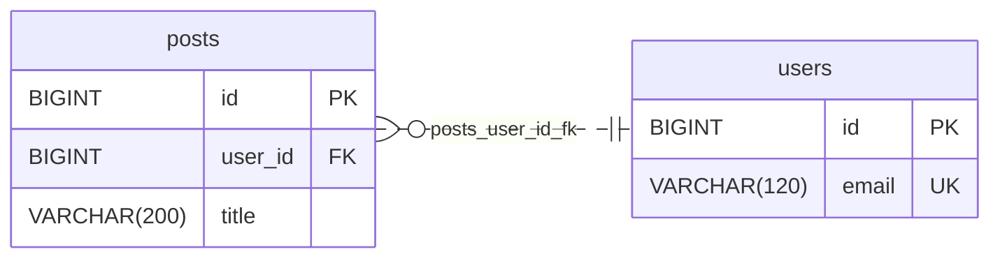

# UML Studio DDL to Mermaid

`CREATE TABLE` DDL 문자열을 ERD 모델과 Mermaid `erDiagram` 소스로 변환하는 Node.js 라이브러리입니다.
예를 들어 `schema.sql`이 바뀔 때 문서의 ERD를 다시 생성하는 데 사용할 수 있습니다.
Node.js 24 이상에서 실행되며 런타임 의존성이 없습니다.

## 설치와 예제 실행

저장소 루트에서 패키지를 만듭니다.

```sh
npm pack ./packages/ddl-to-mermaid
```

별도의 Node.js 프로젝트에서 생성된 `.tgz`의 경로를 지정해 설치합니다.

```sh
npm install /path/to/uml-studio-ddl-to-mermaid-0.1.0.tgz
node node_modules/uml-studio-ddl-to-mermaid/examples/convert.mjs > schema.mmd
```

예제는 인수를 생략하면 함께 제공되는 [샘플 SQL](examples/schema.sql)을 읽습니다. 다른 파일을 사용하려면
`convert.mjs` 뒤에 SQL 파일 경로를 넣으세요. 가져오기 경고는 표준 오류에 출력됩니다.

샘플 SQL은 다음 ERD를 생성합니다.



## API

```js
import { readFile } from 'node:fs/promises';
import { ddlToMermaid } from 'uml-studio-ddl-to-mermaid';

const sql = await readFile('./schema.sql', 'utf8');
const { erd, mermaid } = ddlToMermaid(sql, { diagramName: 'Database Schema' });
console.log(mermaid);
```

CommonJS에서는 `const { ddlToMermaid } = require('uml-studio-ddl-to-mermaid');`로 불러옵니다.

- `ddlToMermaid(sql, options?)`는 동기 함수입니다. `sql`은 SQL 문자열이고, 선택 옵션 `diagramName`의 기본값은 `Imported DDL`입니다.
- `mermaid`는 `.mmd` 파일이나 Markdown의 `mermaid` 코드 블록에 사용할 수 있는 문자열입니다.
- `erd`는 JSON으로 직렬화할 수 있는 [UML Studio](../../README.md) 형식의 데이터입니다. 테이블과 관계 모델은
  `erd.models`에, 해당 모델을 참조하는 ERD 뷰는 `erd.diagrams[0]`에 있습니다. `erd.importMeta`에서
  테이블·컬럼·연결된 FK 개수와 `warnings` 배열을 확인할 수 있습니다.

## 지원 범위

- PostgreSQL·MySQL·SQLite의 공통 `CREATE TABLE` 구문과 단순 컬럼 인덱스를 분석합니다. SQL을 실행하거나 DB에 접속하지 않습니다.
- 단일 PK 컬럼을 가리키는 단일 컬럼 FK를 관계로 연결합니다. 참조 테이블이 입력에 없거나 FK가 단일 PK를 가리키지 않으면 경고를 반환합니다.
- Mermaid는 테이블, 컬럼, PK·FK·단일 컬럼 UNIQUE 표기와 연결된 관계를 출력합니다. `DEFAULT`, `CHECK`, 인덱스, FK 참조 동작은 ERD 모델에 보존되며 Mermaid 출력에서는 생략됩니다.
- 복합 FK, `ALTER TABLE`, `CREATE TABLE AS`, 함수·식 기반 인덱스와 잘못된 DDL은 예외를 발생시킵니다.

[편집기의 DDL 지원 범위](../../README.md#erd-ddl-가져오기와-내보내기)도 참고할 수 있습니다.
