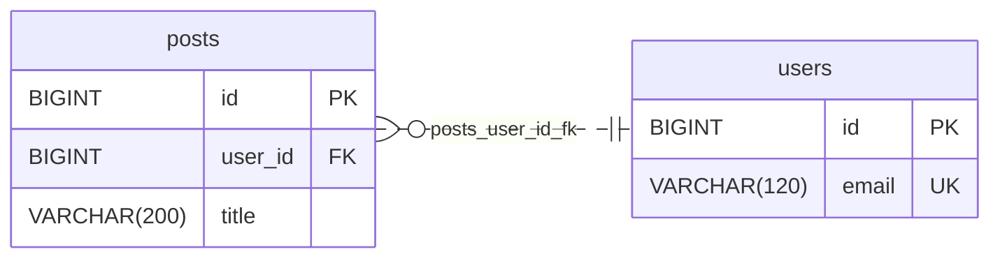

# UML Studio DDL to Mermaid

Convert SQL `CREATE TABLE` statements into an ERD model and Mermaid `erDiagram` source. Use it to regenerate diagrams when your `schema.sql` changes. The library requires Node.js 24 or later and has no runtime dependencies.

## Install and run

From your Node.js project directory, install the package and run the bundled example to generate `schema.mmd`.

```sh
npm install uml-studio-ddl-to-mermaid
node node_modules/uml-studio-ddl-to-mermaid/examples/convert.mjs > schema.mmd
```

The example uses the bundled sample when you omit the SQL path. It writes import warnings to standard error. [Sample SQL](https://github.com/MSbtff/uml-studio/blob/main/packages/ddl-to-mermaid/examples/schema.sql)

Pass a file path to convert your own schema.

```sh
node node_modules/uml-studio-ddl-to-mermaid/examples/convert.mjs ./schema.sql > schema.mmd
```

The bundled sample generates this diagram.



## API

Put your SQL in `schema.sql`, save the following code as `convert.mjs`, and run `node convert.mjs`.

```js
import { readFile } from 'node:fs/promises';
import { ddlToMermaid } from 'uml-studio-ddl-to-mermaid';

const sql = await readFile('./schema.sql', 'utf8');
const { erd, mermaid } = ddlToMermaid(sql, { diagramName: 'Database Schema' });
console.log(mermaid);
```

In CommonJS, load the package with `const { ddlToMermaid } = require('uml-studio-ddl-to-mermaid');`. TypeScript projects can use the same ESM import. The package includes declarations for `DdlOptions`, `DdlConversion`, and `ImportedErd`.

- `ddlToMermaid(sql, options?)` is synchronous. It accepts SQL as a string and uses `Imported DDL` as the default `diagramName`.
- `mermaid` is a string you can write to a `.mmd` file or put in a Markdown `mermaid` code block.
- `erd` is a JSON-serializable UML Studio model. `erd.models` contains table and relationship models, and `erd.diagrams[0]` contains the diagram view. `erd.importMeta` provides table, column, and linked foreign-key counts and a `warnings` array. [UML Studio](https://github.com/MSbtff/uml-studio)

## SQL support

- The converter parses common PostgreSQL, MySQL, and SQLite `CREATE TABLE` syntax and simple column indexes directly from the input text.
- It links single-column foreign keys that reference a single-column primary key. It reports a warning when the referenced table is outside the input or the foreign key points to a column other than a single-column primary key.
- Mermaid output includes tables, columns, primary keys, foreign keys, single-column `UNIQUE` markers, and resolved relationships. The ERD model also preserves `DEFAULT`, `CHECK`, indexes, and foreign-key actions.
- When a column name changes to fit Mermaid syntax, its description retains the original name.
- Composite foreign keys, `ALTER TABLE`, `CREATE TABLE AS`, expression indexes, and invalid DDL raise errors.

[SQL import and export in the UML Studio editor](https://github.com/MSbtff/uml-studio#import-and-export-sql-ddl)
